<picture>
  <source media="(prefers-color-scheme: light)" srcset="assets/hero-light.svg">
  
</picture>

Senior Frontend Developer (Angular) construyendo flujos de desarrollo con IA agnósticos de agente.

 

## QUESTS

<table>
<tr>
<td width="33%"></td>
<td width="33%"></td>
<td width="33%"></td>
</tr>
<tr>
<td width="33%"></td>
<td width="33%"></td>
<td width="33%"></td>
</tr>
<tr>
<td width="33%"></td>
<td width="33%"></td>
<td width="33%"></td>
</tr>
</table>

 

## INVENTORY

 &nbsp;<strong>FRONTEND</strong>

 

          

 &nbsp;<strong>ESTADO &amp; REACTIVIDAD</strong>

 

  

 &nbsp;<strong>IA &amp; TOOLING</strong>

 

     

 &nbsp;<strong>TESTING &amp; CALIDAD</strong>

 

  

 

## SCOREBOARD

 

## REPLAY

<picture>
  <source media="(prefers-color-scheme: light)" srcset="https://raw.githubusercontent.com/Dannii99/Dannii99/output/github-contribution-grid-snake-light.svg">
  
</picture>

 

## BONUS STAGE

<picture>
  <source media="(prefers-color-scheme: light)" srcset="assets/office-light.svg">
  
</picture>

Así se ve mi escritorio a las 2am. No significa nada, solo se veía bonito.

 

## SAVE POINT

