<picture>
  <source media="(prefers-color-scheme: light)" srcset="assets/hero-light.svg">
  
</picture>

Senior Frontend Developer (Angular) construyendo flujos de desarrollo con IA agnósticos de agente.

 

## QUESTS

<picture>
  <source media="(prefers-color-scheme: light)" srcset="assets/quest-ai-arch-light.svg">
  
</picture>

**[FRONTEND AI ARCH](https://github.com/Dannii99/frontend-ai-arch)** · IA agnóstica de agente, Spec-Driven Development.
`Shell` · `OpenSpec` · `Agent Skills`

 

<picture>
  <source media="(prefers-color-scheme: light)" srcset="assets/quest-bold-dashboard-light.svg">
  
</picture>

**[BOLD DASHBOARD](https://github.com/Dannii99/bold-transactions-dashboard)** · Dashboard fintech: transacciones en vivo.
`Angular 20` · `PrimeNG` · `Tailwind CSS`

 

<picture>
  <source media="(prefers-color-scheme: light)" srcset="assets/quest-precuenta-light.svg">
  
</picture>

**[PRECUENTA APP](https://github.com/Dannii99/precuenta-app)** · Captura precios con cámara, mira crecer tu total.
`Angular` · `TypeScript`

 

<picture>
  <source media="(prefers-color-scheme: light)" srcset="assets/quest-portfolio-light.svg">
  
</picture>

**[MY PORTFOLIO](https://github.com/Dannii99/my-portfolio)** · Portafolio personal en Next.js.
`Next.js` · `TypeScript`

 

## INVENTORY

 &nbsp;<strong>FRONTEND</strong>

 

 &nbsp;<strong>ESTADO &amp; REACTIVIDAD</strong>

 

`Signals` · `NgRx` · `RxJS`

 &nbsp;<strong>IA &amp; TOOLING</strong>

 

`Spec-Driven Development` · `OpenSpec` · `Agent Skills`

 &nbsp;<strong>TESTING &amp; CALIDAD</strong>

 

`Playwright` · `Accesibilidad WCAG` · `Clean Code`

 

## SCOREBOARD

 

## REPLAY

<picture>
  <source media="(prefers-color-scheme: light)" srcset="https://raw.githubusercontent.com/Dannii99/Dannii99/output/github-contribution-grid-snake-light.svg">
  
</picture>

 

## ACHIEVEMENTS

<picture>
  <source media="(prefers-color-scheme: light)" srcset="assets/achievements-light.svg">
  
</picture>

<code>PLAYER JOINED · DEV ANGULAR</code> → <code>LEVEL UP · BANCA / FINTECH</code> → <code>SENIOR UNLOCKED</code> → <code>FRONTEND AI ARCHITECT UNLOCKED</code>

 

## SAVE POINT

<picture>
  <source media="(prefers-color-scheme: light)" srcset="assets/save-point-light.svg">
  
</picture>

<a href="https://www.linkedin.com/in/danny-ospino-82360b211/">LinkedIn</a> · <a href="mailto:dannii.ospino@gmail.com">Email</a> · <a href="https://github.com/Dannii99">GitHub</a>

